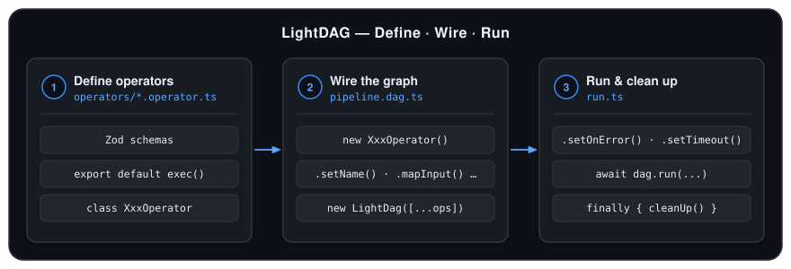
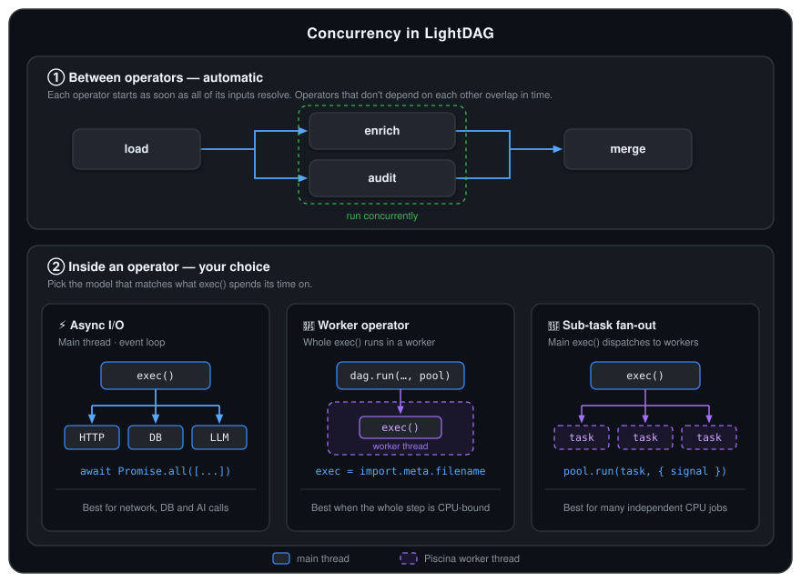

# LightDAG

A lightweight, schema-validated Directed Acyclic Graph (DAG) execution engine for TypeScript and Node.js.

<p align="center">
  
</p>

- **Contract-First**: Inputs, branched outputs, shared dependencies (`requires`), and runtime `options` are validated at runtime with [Zod](https://github.com/colinhacks/zod).
- **Decoupled Namespace**: Operators use local schema keys and are wired into any graph via `.setName()`, `.mapInput()`, `.mapOutput()`, `.mapRequires()`, and `.mapOptions()`.
- **Worker-Ready**: Run operators on the main event loop or offload CPU-heavy work to [Piscina](https://github.com/piscinajs/piscina) worker threads.
- **Safe Lifecycle**: Built-in `DagNodeError` attribution, `setOnError` alerting hook, cooperative `AbortSignal` cancellation, and automatic draining of in-flight operators before cleanup.

---

## Recommended Project Structure

Organize your application into three layers: **one file per operator** (`operators/*.operator.ts`), **graph assembly** (`*.dag.ts`), and **runtime entry** (`run.ts`):

```
src/
├── operators/
│   ├── fetchItems.operator.ts       # Single-file operator (schemas + exec + class)
│   ├── truncateItems.operator.ts    # Reusable operator instantiated multiple times
│   ├── formatReport.operator.ts     # Exports both main-thread & worker-thread classes
│   └── workers/
│       └── _parse.ts                # Optional helper script for per-item worker tasks
├── pipeline.dag.ts                  # Instantiates operators, maps keys, exports LightDag
└── run.ts                           # Configures hooks, runs the DAG, cleans up resources
```

---

## 1. Defining an Operator (`*.operator.ts`)

Each `*.operator.ts` file is self-contained and follows a 4-part layout:

1. **Zod Schemas & Types**:
   - `input_schema` — upstream task outputs required by this operator.
   - `output_schemas` — a map of `{ [branch]: z.ZodObject }` defining the output shape of each branch (typically `{ default: ... }`).
   - `requires_schema` *(optional)* — shared runtime clients (DB repositories, SDK clients, Piscina pool) pulled from `context`.
   - `options_schema` *(optional)* — runtime parameters pulled from `options`.
2. **Default-Exported `exec` Function**:
   - Exporting `exec` as `export default` lets the same file serve as a Piscina worker entrypoint when `exec = import.meta.filename`.
3. **In-Process Operator Class**:
   - Extends `Operator` with `exec = <fn>`.
4. **Worker-Thread Operator Class *(optional)***:
   - Extends `Operator` with `exec = import.meta.filename`.

```ts
import * as z from "zod";
import { Operator, type OperatorArgs, type OperatorOutput } from "light-dag";

// 1. Schemas & inferred types
export const FormatReportOptionsSchema = z.object({
    title: z.string().default("Daily Report")
});
export type FormatReportOptions = z.infer<typeof FormatReportOptionsSchema>;

const FormatReportInputSchema = z.object({
    items: z.array(z.string())
});
type FormatReportInput = z.infer<typeof FormatReportInputSchema>;

const FormatReportOutputSchema = z.object({
    report: z.string()
});

// 2. Default-exported exec function
export default async function formatReport(
    { inputs, options }: OperatorArgs
): Promise<OperatorOutput> {
    const { items } = inputs as FormatReportInput;
    const { title } = options as FormatReportOptions;

    const report = [`# ${title}`, ...items.map((item, i) => `${i + 1}. ${item}`)].join("\n");
    return { branch: "default", output: { report } };
}

// 3. In-process operator (runs on the main thread)
export class FormatReportOperator extends Operator {
    override name = "format_report";
    override input_schema = FormatReportInputSchema;
    override output_schemas = { default: FormatReportOutputSchema };
    override options_schema = FormatReportOptionsSchema;
    override exec = formatReport;
}

// 4. Optional worker-thread variant (runs the whole file in a Piscina worker thread)
export class FormatReportOperatorThread extends Operator {
    override name = "format_report";
    override input_schema = FormatReportInputSchema;
    override output_schemas = { default: FormatReportOutputSchema };
    override options_schema = FormatReportOptionsSchema;
    override exec = import.meta.filename;
}
```

> [!IMPORTANT]
> Keep schema keys local to the operator (e.g. `items`, `report`). Never hardcode pipeline-specific task names inside `*.operator.ts`—remap them in `*.dag.ts` instead.

---

## 2. Implementing `exec`

### 2.1 Contract & Error Handling

```ts
export default async function myExec(
    { inputs, requires, options, signal }: OperatorArgs
): Promise<OperatorOutput> {
    // 1. Cast validated inputs / requires / options
    // 2. Perform work (throw directly on failure)
    // 3. Return the selected branch and its output object
    return { branch: "default", output: { ... } };
}
```

- **Return Value**: `{ branch, output }`. `branch` selects which schema in `output_schemas` validates `output` and which downstream branch wakes up.
- **Error Handling**: **Do not** wrap `exec` in `try/catch` to return an `"error"` branch. Throw a normal `Error` (or let async calls reject); `LightDag` automatically wraps it in `DagNodeError(node_name, cause)` and triggers `setOnError`.

---

### 2.2 Concurrency Models

Concurrency in `LightDAG` works at **two levels**:

1. **Between operators (automatic)**: Every operator starts immediately once all of its input promises resolve. Independent branches run concurrently without extra configuration.
2. **Inside a single operator's `exec` (your choice)**: Because Node.js runs JavaScript on a single event-loop thread, choose the pattern below based on whether `exec` is **I/O-bound** or **CPU-bound**:

<p align="center">
  
</p>

| Pattern | Where It Runs | When to Use | How to Write It |
| :--- | :--- | :--- | :--- |
| **1. Async I/O** (`Promise.all` / `Promise.allSettled`) | Main event loop (single thread, overlapping I/O wait) | Database queries, HTTP API calls, LLM requests | Fire promises concurrently inside `exec` (`Promise.all` for all-or-nothing; `Promise.allSettled` to tolerate partial failures) |
| **2. Worker Operator** (`exec = import.meta.filename`) | Piscina OS worker thread | The **entire operator** is CPU-heavy (e.g. large Markdown/JSON rendering) and needs no uncloneable `requires` | Define a `*Thread` class with `exec = import.meta.filename` and pass `pool` to `dag.run(...)` |
| **3. Sub-Task Fan-Out** (`thread_pool.run()`) | Main `exec` coordinates; sub-tasks run across Piscina worker threads | One operator processes **many categories/articles in parallel** with CPU-heavy parsing + HTTP fetching | Inject `thread_pool: z.instanceof(Piscina)` via `requires_schema` and fan out with `Promise.allSettled(items.map(x => thread_pool.run(x, { filename, signal })))` |

```ts
// Pattern 1: Concurrent I/O on the event loop (DB / LLM / HTTP)
const results = await Promise.all(categories.map(cat => repo.findRecent(cat)));

// Pattern 3: Fan out CPU-heavy per-category tasks to Piscina worker threads
const tasks = categories.map(category =>
    thread_pool.run(
        { category, options },
        { filename: new URL("./workers/_fetch.js", import.meta.url).href, signal }
    )
);
const settled = await Promise.allSettled(tasks);
```

---

### 2.3 Cooperative Cancellation (`signal`)

`signal?: AbortSignal` is automatically injected into `OperatorArgs` and aborts whenever `dag.run()` times out or any concurrent operator throws. Use it to stop work early:

```ts
// A. Pass directly to signal-aware APIs (fetch, Axios, OpenAI SDK, Piscina pool.run)
const res = await fetch(url, { signal });

// B. Check before each step in a loop
for (const item of items) {
    signal?.throwIfAborted();
    await processItem(item);
}

// C. Clean up custom timers or streams on abort
signal?.addEventListener("abort", () => clearTimeout(timer), { once: true });
```

---

## 3. Wiring & Running a DAG (`*.dag.ts` & `run.ts`)

### 3.1 Namespace Mapping, Reuse & Conditional Branching

By default, an operator's local schema keys are used as global DAG task names. When wiring `*.dag.ts`, use chainable methods to connect operators, reuse the same operator class multiple times, or route conditional branches:

| Method | Purpose |
| :--- | :--- |
| `.setName(name)` | Set a unique node name (required when instantiating the same operator class more than once) |
| `.mapInput(local, global)` | Connect local `input_schema` key `local` to upstream global task `global` |
| `.mapOutput(local, global)` | Publish local `output_schemas` key `local` under global task name `global` |
| `.mapRequires(local, global)` | Pull local `requires_schema` key `local` from `context[global]` |
| `.mapOptions(local, global)` | Pull local `options_schema` key `local` from `options[global]` |

<p align="center">
  
</p>

### 3.2 Assembling the Graph (`*.dag.ts`)

```ts
import { LightDag } from "light-dag";
import { RouteAlertOperator } from "./operators/routeAlert.operator.js";
import { SendChannelOperator } from "./operators/sendChannel.operator.js";
import { MergeStatusOperator } from "./operators/mergeStatus.operator.js";

const router = new RouteAlertOperator(); // Outputs: urgent -> { urgent_msg } | normal -> { normal_msg }

// Reuse SendChannelOperator three times with distinct names, inputs, outputs, and options
const send_sms = new SendChannelOperator()
    .setName("send_sms")
    .mapInput("payload", "urgent_msg")
    .mapOutput("delivered", "sms_sent")
    .mapOptions("channel_label", "sms_label");

const send_email = new SendChannelOperator()
    .setName("send_email")
    .mapInput("payload", "urgent_msg")
    .mapOutput("delivered", "email_sent")
    .mapOptions("channel_label", "email_label");

const urgent_merge = new MergeStatusOperator("urgent_merge", ["sms_sent", "email_sent"], "urgent_done");

const send_log = new SendChannelOperator()
    .setName("send_log")
    .mapInput("payload", "normal_msg")
    .mapOutput("delivered", "normal_done")
    .mapOptions("channel_label", "log_label");

export const alert_dag = new LightDag([router, send_sms, send_email, urgent_merge, send_log]);
```

### 3.3 Running the DAG & Cleaning Up (`run.ts`)

`dag.run()` always waits for all in-flight operators to finish (or abort) before returning or rethrowing, so closing database connections and worker pools in `finally` is race-free:

```ts
import { DagNodeError } from "light-dag";
import { alert_dag } from "./branching.dag.js";

alert_dag.setDebug(true);       // Validate graph topology & log operator start/end
alert_dag.setTimeout(30_000);   // Abort the run if it exceeds 30s
alert_dag.setOnError(async (err: DagNodeError) => {
    await notifyAdmin(`Operator "${err.node_name}" failed`, err.cause);
});

try {
    const res = await alert_dag.run(
        { severity: "high", message: "DB CPU at 98%" }, // inputs
        ["urgent_done"],                                // requested outputs
        { db: dataSource },                             // context (for requires_schema)
        { sms_label: "SMS", email_label: "EMAIL" },     // options (for options_schema)
        workerPool                                      // Piscina pool (for *Thread operators)
    );
    console.log("Completed:", res.urgent_done);
} catch (err) {
    if (err instanceof DagNodeError) {
        console.error(`Failed at node "${err.node_name}":`, err.cause);
    } else {
        console.error("Execution aborted:", err);
    }
} finally {
    await workerPool.destroy();
    await dataSource.destroy();
}
```

---

## 4. Runnable Examples

Complete, self-contained examples live in [`./examples`](./examples) (excluded from `npm run build`):

```
examples/
├── 01-basic-pipeline/          # Single-file operators, requires/options, reusing an operator twice
├── 02-conditional-branching/   # Multi-branch routing (urgent vs. normal) + MergeStatusOperator barrier
└── 03-error-and-cancellation/  # DagNodeError, setOnError hook, AbortSignal cleanup, safe finally teardown
```

```bash
npx tsx examples/01-basic-pipeline/run.ts
npx tsx examples/02-conditional-branching/run.ts
npx tsx examples/03-error-and-cancellation/run.ts
```
