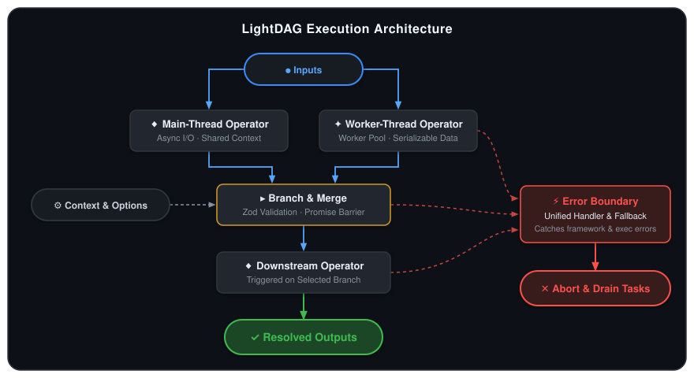
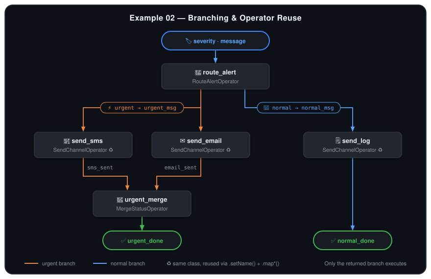

# LightDAG

A lightweight, promise-driven DAG execution engine for TypeScript and Node.js.

<p align="center">
  
</p>

- **Automatic Concurrency**: Nodes run in parallel automatically as soon as their upstream inputs resolve—no manual topological scheduling needed.
- **Zod Validation**: Runtime validation for `inputs`, branched `outputs`, shared `requires`, and `options`.
- **Flexible Execution**: Supports main-thread async operators, [Piscina](https://github.com/piscinajs/piscina) worker-thread operators, conditional branching, and operator reuse.
- **Unified Error Boundary**: Built-in framework error catching, centralized `setOnError(err, node_name)`, cooperative `AbortSignal` cancellation, and automatic in-flight task draining before cleanup.

---

## Recommended Project Structure

Organize your application into three layers: **one file per operator** (`operators/*.operator.ts`), **graph assembly** (`*.dag.ts`), and **runtime entry** (`run.ts`):

```
src/
├── operators/
│   ├── fetchItems.operator.ts       # Single-file operator (schemas + exec + class)
│   ├── truncateItems.operator.ts    # Reusable operator instantiated multiple times
│   └── formatReport.operator.ts     # Optional main-thread & worker-thread classes
├── pipeline.dag.ts                  # Instantiates operators, maps keys, exports LightDag
└── run.ts                           # Configures hooks, runs the DAG, cleans up resources
```

---

## 1. Defining an Operator (`*.operator.ts`)

Each `*.operator.ts` file is self-contained:

1. **Zod Schemas & Types**: `input_schema`, `output_schemas` (`{ [branch]: z.ZodObject }`), plus optional `requires_schema` (`context`) and `options_schema` (`options`).
2. **Default-Exported `exec` Function**: Exporting as `export default` allows the same file to act as a Piscina worker entrypoint.
3. **In-Process Operator Class**: Extends `Operator` with `exec = <fn>`.
4. **Worker-Thread Operator Class *(optional)***: Extends `Operator` with `exec = import.meta.filename`. When a `Piscina` pool is passed to `dag.run(...)`, the framework executes this file's `export default` function in a worker thread.

```ts
import * as z from "zod";
import { Operator, type OperatorArgs, type OperatorOutput } from "light-dag";

// 1. Schemas & inferred types
export const FormatReportOptionsSchema = z.object({
    title: z.string().default("Daily Report")
});
export type FormatReportOptions = z.infer<typeof FormatReportOptionsSchema>;

const FormatReportInputSchema = z.object({
    items: z.array(z.string())
});
type FormatReportInput = z.infer<typeof FormatReportInputSchema>;

const FormatReportOutputSchema = z.object({
    report: z.string()
});

// 2. Default-exported exec function
export default async function formatReport(
    { inputs, options }: OperatorArgs
): Promise<OperatorOutput> {
    const { items } = inputs as FormatReportInput;
    const { title } = options as FormatReportOptions;

    const report = [`# ${title}`, ...items.map((item, i) => `${i + 1}. ${item}`)].join("\n");
    return { branch: "default", output: { report } };
}

// 3. In-process operator (runs on the main thread)
export class FormatReportOperator extends Operator {
    override name = "format_report";
    override input_schema = FormatReportInputSchema;
    override output_schemas = { default: FormatReportOutputSchema };
    override options_schema = FormatReportOptionsSchema;
    override exec = formatReport;
}

// 4. Optional worker-thread variant (runs the whole file in a Piscina worker thread)
export class FormatReportOperatorThread extends Operator {
    override name = "format_report";
    override input_schema = FormatReportInputSchema;
    override output_schemas = { default: FormatReportOutputSchema };
    override options_schema = FormatReportOptionsSchema;
    override exec = import.meta.filename;
}
```

> [!NOTE]
> **Worker Thread Limitation**: Arguments crossing into and out of a worker-thread operator (`inputs`, `requires`, `options`, and `output`) are transferred via Node.js structured cloning (`postMessage`). Only serializable data (primitives, plain objects, arrays, `Map`/`Set`, `Date`, `Uint8Array`, etc.) can be passed—non-serializable values such as database connections, SDK clients, functions, or class instances with methods cannot be passed to a worker-thread operator.

---

## 2. Implementing `exec`

```ts
export default async function myExec(
    { inputs, requires, options, signal }: OperatorArgs
): Promise<OperatorOutput> {
    const res = await fetch(url, { signal }); // pass signal to cancel in-flight I/O on abort

    for (const item of items) {
        signal?.throwIfAborted();             // or check signal inside loops
        await processItem(item);
    }

    return { branch: "default", output: { ... } };
}
```

- **Return Contract**: `{ branch, output }`. `branch` picks the matching schema in `output_schemas` to validate `output` and unblocks only that branch's downstream tasks.
- **Error Handling**: Throw errors directly inside `exec` (no need to catch or wrap them). Any uncaught exception is caught by `LightDag` and routed to `setOnError(err, node_name)`—or logged via the framework fallback.
- **Cooperative Cancellation (`signal`)**: `signal?: AbortSignal` is injected automatically and aborts on timeout or when another operator fails. Pass it to signal-aware APIs (`fetch`, SDKs, `pool.run`), call `signal?.throwIfAborted()`, or attach a cleanup listener with `signal?.addEventListener("abort", ...)`.

---

## 3. Wiring & Running a DAG (`*.dag.ts` & `run.ts`)

### 3.1 Namespace Mapping, Reuse & Conditional Branching

By default, an operator's local schema keys are used as global DAG task names. When wiring `*.dag.ts`, use chainable methods to connect operators, reuse the same operator class multiple times, or route conditional branches:

| Method | Purpose |
| :--- | :--- |
| `.setName(name)` | Set a unique node name (required when instantiating the same operator class more than once) |
| `.mapInput(local, global)` | Connect local `input_schema` key `local` to upstream global task `global` |
| `.mapOutput(local, global)` | Publish local `output_schemas` key `local` under global task name `global` |
| `.mapRequires(local, global)` | Pull local `requires_schema` key `local` from `context[global]` |
| `.mapOptions(local, global)` | Pull local `options_schema` key `local` from `options[global]` |

<p align="center">
  
</p>

### 3.2 Assembling the Graph (`*.dag.ts`)

```ts
import { LightDag } from "light-dag";
import { RouteAlertOperator } from "./operators/routeAlert.operator.js";
import { SendChannelOperator } from "./operators/sendChannel.operator.js";
import { MergeStatusOperator } from "./operators/mergeStatus.operator.js";

const router = new RouteAlertOperator(); // Outputs: urgent -> { urgent_msg } | normal -> { normal_msg }

// Reuse SendChannelOperator three times with distinct names, inputs, outputs, and options
const send_sms = new SendChannelOperator()
    .setName("send_sms")
    .mapInput("payload", "urgent_msg")
    .mapOutput("delivered", "sms_sent")
    .mapOptions("channel_label", "sms_label");

const send_email = new SendChannelOperator()
    .setName("send_email")
    .mapInput("payload", "urgent_msg")
    .mapOutput("delivered", "email_sent")
    .mapOptions("channel_label", "email_label");

const urgent_merge = new MergeStatusOperator("urgent_merge", ["sms_sent", "email_sent"], "urgent_done");

const send_log = new SendChannelOperator()
    .setName("send_log")
    .mapInput("payload", "normal_msg")
    .mapOutput("delivered", "normal_done")
    .mapOptions("channel_label", "log_label");

export const alert_dag = new LightDag([router, send_sms, send_email, urgent_merge, send_log]);
```

### 3.3 Running the DAG & Cleaning Up (`run.ts`)

`dag.run()` catches all errors internally and returns `undefined` on failure:
- **Framework-level errors** (schema mismatch, missing input/output task, cycle detection, or timeout) are logged directly by the framework.
- **Operator `exec` errors** (any exception thrown by user code) are routed to a single DAG-level `setOnError(err, node_name)` handler (or logged by the framework's default fallback if omitted). You do not define handlers per operator—branch on `node_name` inside `setOnError` when specific operators require custom recovery.
- All in-flight operators are drained before `dag.run()` returns, so `try / finally` resource cleanup is always race-free without needing a `catch` block:

```ts
import { alert_dag } from "./branching.dag.js";

alert_dag.setDebug(true);       // Validate graph topology & log operator start/end
alert_dag.setTimeout(30_000);   // Abort the run if it exceeds 30s
alert_dag.setOnError(async (err, node_name) => {
    if (node_name === "send_sms") {
        await triggerSmsFallback(err);
    } else if (node_name === "send_email") {
        await queueEmailRetry(err);
    } else {
        await notifyAdmin(`Operator "${node_name}" failed`, err);
    }
});

try {
    const res = await alert_dag.run(
        { severity: "high", message: "DB CPU at 98%" }, // inputs
        ["urgent_done"],                                // requested outputs
        { db: dataSource },                             // context (for requires_schema)
        { sms_label: "SMS", email_label: "EMAIL" },     // options (for options_schema)
        workerPool                                      // Piscina pool (for *Thread operators)
    );
    if (res) {
        console.log("Completed:", res.urgent_done);
    }
} finally {
    await workerPool.destroy();
    await dataSource.destroy();
}
```

---

## 4. Runnable Examples

Complete, self-contained examples live in [`./examples`](./examples) (excluded from `npm run build`):

```
examples/
├── 01-basic-pipeline/          # Single-file operators, requires/options, reusing an operator twice
├── 02-conditional-branching/   # Multi-branch routing (urgent vs. normal) + MergeStatusOperator barrier
└── 03-error-and-cancellation/  # Default error fallback, setOnError hook, AbortSignal cleanup, safe finally teardown
```

```bash
npx tsx examples/01-basic-pipeline/run.ts
npx tsx examples/02-conditional-branching/run.ts
npx tsx examples/03-error-and-cancellation/run.ts
```
