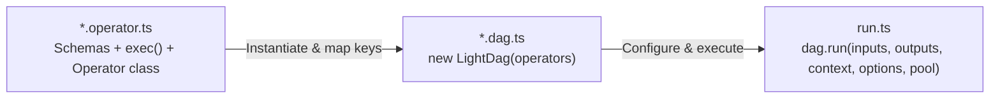
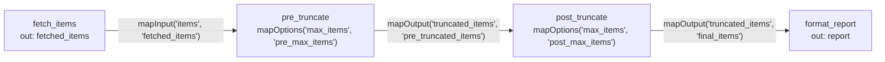

# LightDAG

A lightweight, schema-validated Directed Acyclic Graph (DAG) execution engine for TypeScript and Node.js.

## Overview & Project Convention

`light-dag` cleanly separates **single-file operators**, **DAG wiring**, and **runtime execution**:



- **Recommended directory layout**:
  - `operators/<name>.operator.ts` — One operator per file.
  - `<pipeline>.dag.ts` — Graph assembly, instance naming, and key mapping.
  - `run.ts` — Runtime options, `setOnError` alerting, execution, and resource cleanup.

---

## 1. Defining an Operator (`*.operator.ts`)

Each `*.operator.ts` file defines four parts:

1. **Zod Schemas & Types**: Local `InputSchema`, `OutputSchema` (per branch), optional `RequiresSchema` (context dependencies), and optional `OptionsSchema`.
2. **Default-exported `exec` function**: `export default async function <name>(args: OperatorArgs): Promise<OperatorOutput>`.
3. **In-process Operator class**: Extends `Operator` with `exec = <name>`.
4. **Thread variant *(optional)***: Extends `Operator` with `exec = import.meta.filename` to offload the whole operator to a Piscina worker thread.

```ts
import * as z from "zod";
import { Operator, type OperatorArgs, type OperatorOutput } from "light-dag";

export const MyOptionsSchema = z.object({ limit: z.number().int().positive().default(10) });
const MyInputSchema = z.object({ items: z.array(z.string()) });
const MyOutputSchema = z.object({ result: z.array(z.string()) });
const MyRequiresSchema = z.object({ client: z.instanceof(ApiClient) });

export default async function myTask({ inputs, requires, options, signal }: OperatorArgs): Promise<OperatorOutput> {
    // Business logic...
    return { branch: "default", output: { result: [] } };
}

export class MyOperator extends Operator {
    override name = "my_task";
    override input_schema = MyInputSchema;
    override output_schemas = { default: MyOutputSchema };
    override requires_schema = MyRequiresSchema;
    override options_schema = MyOptionsSchema;
    override exec = myTask;
}
```

> **Rule**: Keep schema keys local to the operator. Never hardcode pipeline-specific wiring names inside `*.operator.ts`—use mapping methods in `*.dag.ts` instead.

---

## 2. Implementing `exec`

### Contract & Error Handling

- **Arguments (`OperatorArgs`)**: `{ inputs, requires, options, signal }`, pre-validated against your Zod schemas.
- **Return value (`OperatorOutput`)**: `{ branch, output }`, where `branch` defaults to `"default"` and must match a key in `output_schemas`.
- **Errors**: Simply `throw` on failure—do **not** wrap `exec` in `try/catch` or return fake `"error"` branches. The engine wraps failures in `DagNodeError(node_name, cause)`.

### Concurrency Patterns

| Workload | Recommended Approach |
|---|---|
| In-memory transform | Plain synchronous logic inside `async exec` |
| Parallel I/O (all must succeed) | `await Promise.all(...)` |
| Parallel I/O (partial failure tolerated) | `await Promise.allSettled(...)` (throw only if all fail) |
| CPU-heavy whole operator | Export an `OperatorThread` variant with `exec = import.meta.filename` |
| CPU-heavy sub-tasks per item | Inject a `Piscina` pool via `requires_schema` and call `pool.run(..., { signal })` |

### Cooperative Cancellation (`signal`)

`signal?: AbortSignal` is injected automatically (do not declare it in `input_schema`). Forward or check it in long-running operators:

```ts
// 1. Forward to signal-aware APIs (fetch, AI SDKs, Piscina)
const res = await fetch(url, { signal });

// 2. Guard loops
for (const item of items) {
    signal?.throwIfAborted();
    await process(item);
}
```

---

## 3. Wiring & Running a DAG (`*.dag.ts` & `run.ts`)

### Namespace Mapping & Operator Reuse

Global task names default to each operator's local schema keys. Use chainable mapping methods in `*.dag.ts` to connect nodes or reuse the same operator class multiple times:

| Method | Purpose |
|---|---|
| `.setName(name)` | Assign a unique instance name within the DAG |
| `.mapInput(local, global)` | Bind a local `input_schema` key to a global task name |
| `.mapOutput(local, global)` | Bind a local `output_schemas` key to a global task name |
| `.mapRequires(local, global)` | Bind a local `requires_schema` key to a key in `context` |
| `.mapOptions(local, global)` | Bind a local `options_schema` key to a key in `options` |



### Wiring (`*.dag.ts`)

```ts
const pre_truncate = new TruncateItemsOperator()
    .setName("pre_truncate")
    .mapInput("items", "fetched_items")
    .mapOutput("truncated_items", "pre_truncated_items")
    .mapOptions("max_items", "pre_max_items");

export const pipeline_dag = new LightDag([fetch_op, pre_truncate, format_op]);
```

### Execution, Alerting & Cleanup (`run.ts`)

```ts
pipeline_dag.setDebug(config.debug);
pipeline_dag.setTimeout(30_000);
pipeline_dag.setOnError(async (err: DagNodeError) => {
    await alertClient.notify(`Node "${err.node_name}" failed`, err.cause);
});

try {
    const outputs = await pipeline_dag.run(inputs, ["report"], context, options, pool);
    console.log(outputs.report);
} catch (err) {
    if (err instanceof DagNodeError) console.error(err.node_name, err.cause);
    else console.error("Execution aborted:", err);
} finally {
    await cleanUp(); // Safe: in-flight operators have finished before run() exits
}
```

- **Debug Mode (`setDebug(true)`)**: Runs static checks before execution—throws on cycles and warns on missing producers, duplicate producers, input/output collisions, or unused tasks.

---

## Examples

Runnable end-to-end examples live in [`./examples`](./examples):

| Example | Demonstrates | Run |
|---|---|---|
| [`01-basic-pipeline`](./examples/01-basic-pipeline) | Single-file operators, `requires` / `options`, reusing `TruncateItemsOperator` twice via `.setName()` and `.map*()`, and `setDebug(true)` | `npx tsx examples/01-basic-pipeline/run.ts` |
| [`02-conditional-branching`](./examples/02-conditional-branching) | Multi-branch `output_schemas` (`urgent` / `normal`) and `MergeStatusOperator` barrier | `npx tsx examples/02-conditional-branching/run.ts` |
| [`03-error-and-cancellation`](./examples/03-error-and-cancellation) | `DagNodeError`, `setOnError`, cooperative `AbortSignal` cleanup, and safe `finally` teardown | `npx tsx examples/03-error-and-cancellation/run.ts` |
